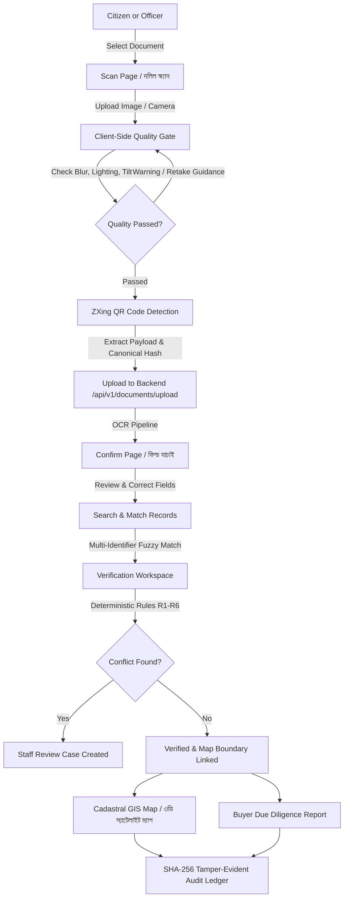

# 🏗️ LandTech Frontend Reconstruction Architecture & Workflow Guide

## 1. Executive Summary

This document outlines the complete architectural reconstruction of the LandTech frontend platform for the national hackathon demonstration.

### Core Objectives Achieved
1. **Visual System Rebuild**: Dual-theme support with pure dark (black & emerald `#070B09`, `#10B981`) and elegant light (white & emerald `#F8FAF9`, `#047857`).
2. **Interactive 3D Cadastral Radar**: Reusable SVG/CSS 3D isometric cadastral radar scene (`CadastralScene.tsx`) with animated radar sweep, coordinate telemetry (`23° 48' N, 90° 22' E`), and interactive parcel polygons.
3. **End-to-End Functional Workflows**:
   - Document Scanning with Quality Pre-check & QR Code detection (`ScanPage.tsx`).
   - OCR Extracted Field Review & Correction (`ConfirmPage.tsx`).
   - Khatian & Record Search with RapidFuzz Matching (`SearchPage.tsx`).
   - Authenticity Verification with Conflict Detection (`VerificationPage.tsx`).
   - Interactive Cadastral GIS Map (`MapPage.tsx`) using MapLibre GL & PostGIS.
   - Buyer Due Diligence Report (`BuyerReportPage.tsx`).
   - Cryptographic SHA-256 Audit Ledger (`AdminPage.tsx`).
   - Offline Queue Management with Dexie.js (`PendingUploadsPage.tsx`).
4. **Clean Authentication & RBAC**: No legacy "RBAC Access Control Terminal" wording. Split into Citizen Portal and Government Officials Portal.
5. **Full Bilingual Support**: Live toggle between English and Bengali with persistent preferences.

---

## 2. Complete End-to-End Workflow: How to Use the System

---

## 3. Step-by-Step Feature Walkthrough

### Step 1: Document Scan & Quality Assessment (`ScanPage`)
- **Where to find it**: Click **"দলিল স্ক্যান"** from the Home Page or Sidebar.
- **How it works**:
  1. Click **"ছবি আপলোড করুন / Upload Image"** and choose one of the sample files from `d:\LAND OS\sample_test_documents\`.
  2. The **Client-side Quality Gate Worker** immediately calculates blur metric, brightness, and rotation.
  3. The **QR Scanner (`zxing-wasm`)** detects any embedded QR code and displays the decoded khatian payload (`khatian/7334`).
  4. The image is compressed and dispatched to the backend FastAPI upload endpoint.

### Step 2: Extracted Field Confirmation (`ConfirmPage`)
- **Where to find it**: Automatically opens after upload completes, or via navigation.
- **How it works**:
  - Displays side-by-side view of the document and extracted fields:
    - খতিয়ান নম্বর (Khatian No.)
    - দাগ নম্বর (Dag No.)
    - মৌজা (Mouza) ও জে এল নম্বর (JL No.)
    - মালিকের নাম (Owner Name)
    - জমির পরিমাণ (Area in Decimals)
  - Users can correct OCR mistakes. Changes update trust status to `USER_CORRECTED`.

### Step 3: Record Search & Candidate Matching (`SearchPage`)
- **Where to find it**: Click **"রেকর্ড অনুসন্ধান"** or click "Search Records" from the confirmation page.
- **How it works**:
  - Queries 5,250 seeded land records in SQLite/PostgreSQL.
  - Computes RapidFuzz similarity across Bengali names and survey identifiers.
  - Flags potential duplicate deeds or inheritance conflicts.

### Step 4: Verification & Integrity Center (`VerificationPage`)
- **Where to find it**: Navigation menu -> **"ভেরিফিকেশন / Verification"**.
- **How it works**:
  - Distinguishes between:
    - **OCR Extracted**: Extracted text from uploaded paper.
    - **QR Code Verified**: Payload matches cryptographic hash (integrity check).
    - **Official Source Match**: Record exists in authorized land registry.
    - **Legal Ownership**: Final status requiring human official sign-off when conflicts exist.
  - Enforces Deterministic Rules Gates R1–R6.

### Step 5: Cadastral GIS Map Workspace (`MapPage`)
- **Where to find it**: Navigation menu -> **"ক্যাডাস্ট্রাল ম্যাপ / GIS Map"**.
- **How it works**:
  - Interactive MapLibre GL canvas with parcel layers (`P-4520`, etc.).
  - Click on any parcel polygon to view area, owner history, and conflict warnings in the slide-out inspector drawer.

### Step 6: Buyer Due Diligence Report (`BuyerReportPage`)
- **Where to find it**: Click **"বায়ার রিপোর্ট"** or through the showcase link.
- **How it works**:
  - Generates comprehensive risk score, deed transfer chain, and seller authorization verification.

### Step 7: Tamper-Evident Audit Ledger (`AdminPage`)
- **Where to find it**: Navigation menu -> **"প্রশাসনিক ও অডিট প্যানেল"** (available to authorized staff/admin roles).
- **How it works**:
  - Displays chronological audit ledger with SHA-256 hash chains, verifying that no land record has been altered after registration.

---

## 4. Test Documents Provided
Located at: `d:\LAND OS\sample_test_documents\`
1. `01_Khatian_Badda_North_GOOD.jpg` (BS Survey, বাড্ডা উত্তর, খতিয়ান ৭৩৩৪, দাগ ৮৫০৩/৬, মালিক আবুল কাশেম, QR: `khatian/7334`)
2. `02_Khatian_Senpara_Parbata_GOOD.jpg` (RS Survey, সেনপাড়া পর্বতা, খতিয়ান ৭৮৪, দাগ ৪৯৫৫, মালিক নূরুল হক চৌধুরী, QR: `khatian/784`)
3. `03_Khatian_Birulia_GOOD.jpg` (City Survey, বিরুলিয়া, খতিয়ান ৫৯৩১, দাগ ১২৩৩, মালিক মোকাররম হোসেন, QR: `khatian/5931`)
4. `04_Khatian_Jinjira_GOOD.jpg` (City Survey, জিনজিরা, খতিয়ান ৯০১৩, দাগ ৫৫৩৮, মালিক শামসুল আলম, QR: `khatian/9013`)
5. `05_Khatian_Degraded_Quality_Test_BAD.jpg` (SA Survey, জিনজিরা, খতিয়ান ২৩৮৬, দাগ ২১৭৯/৪, টেস্ট: ঝাপসা/খারাপ আলো - কোয়ালিটি গেট ওয়ার্নিং)
